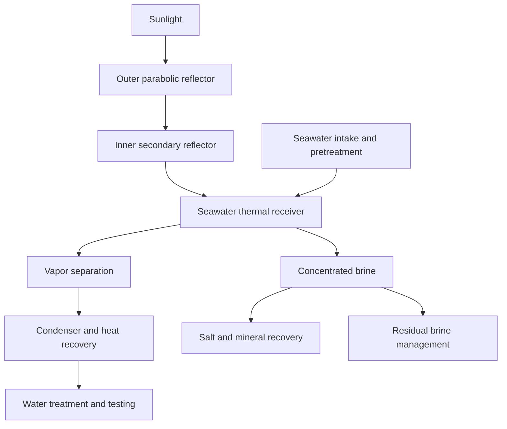

# Bone Ocean — Solar Steam Desalination (SSD)

**EarthDollar research concept | 2026-11-27**

> The bones of the ocean.

Sunlight supplies the energy. Steam carries away the water. Salt and minerals are the bones left behind.

## Concept

Use two nested parabolic reflecting surfaces to concentrate and redirect sunlight into a seawater receiver. Evaporate water, capture the vapor, condense it, and retain the concentrated brine for potential salt and mineral recovery.

The original geometry proposed by the user is water inside a reverse parabola with a second parabolic mirror inside it. The exact orientation, focal lengths, reflector profiles and receiver position remain design variables, not established optical results. One possible interpretation is an outer concave collector and an inner secondary reflector directing light back toward a receiver near the base.

## Energy and mass balance

Incident solar power is direct normal irradiance multiplied by projected collector aperture area. Absorbed power is incident power times optical and receiver efficiencies, which must be measured or modeled. Mirrors redirect energy; they do not create it. Shading, blocking, reflection losses and imperfect tracking may make a second mirror less efficient than a single mirror.

For an illustrative single-stage evaporation calculation, water initially at 25 °C requires roughly 0.71 kWh of heat per kilogram to reach 100 °C and vaporize at atmospheric pressure (ignoring losses and salinity effects). At 1 kW of incident solar power and 100% conversion, this corresponds to about 1.4 kg of vapor per hour; real single-stage yields are lower. Heat recovery or multiple effects can reduce the external heat needed per kilogram. This example is not a performance claim.

For 1,000 kg of typical seawater at 3.5% dissolved salts, approximately 35 kg is dissolved material and 965 kg is water. Actual freshwater recovery and saleable salt yield depend on process limits, composition, precipitation, purity and waste handling. Not all dissolved solids are sodium chloride.

## Optional power generation

Solar steam desalination is the primary objective. Electricity is an optional cogeneration objective, not a guaranteed output. A turbine requires adequate steam pressure, temperature, flow and a lower-pressure sink. A separate clean working-fluid circuit is preferable to exposing turbines to salt carryover and corrosion. Account for the heat and electrical trade-offs and all auxiliary loads. No perpetual-energy claim is made.

## Experimental validation

1. Ray-trace nested reflectors, including the sun's angular extent, shading, tracking errors and optical losses.
2. Compare against a single parabolic reflector and a simple solar still at matched projected collection area, irradiance, feed conditions and operating time.
3. Measure absorbed heat, collected distillate, brine concentration, water quality and any net electricity.
4. Evaluate condensation heat recovery, corrosion, scaling, cleaning, water treatment and the economic and environmental feasibility of mineral recovery.
5. Report uncertainty and negative results. Test only with appropriate eye, thermal and fire protection; concentrated sunlight can be hazardous. Initial prototypes should be vented and unpressurized; steam pressure systems require professional engineering and certified equipment.

Distilled water is not automatically potable; prevent droplet carryover, verify contaminants, and treat and test against applicable drinking-water standards.

## EarthDollar interface

Record certified potable water (liters), verified saleable mineral output (kg by grade), net electricity (kWh, if applicable), incident solar energy (kWh), aperture area, operating time, costs and residual waste. Compare output per square meter, per day, and per dollar invested.

Bone Ocean is a proposed geometry and resource-production model, not a claim of novelty over existing solar stills, solar thermal concentrators, desalination or salt recovery. No prototype or optical simulation has yet been validated.

Related: [EarthDollar steam-electric cogeneration](steam-electric-cogeneration.md).
