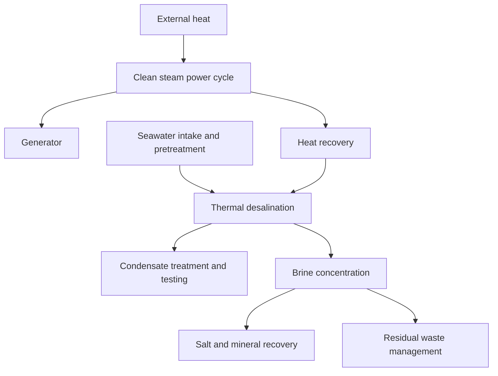

# EarthDollar: Steam-electric cogeneration

Date: 2026-11-27
Status: conceptual engineering proposal; not a validated plant design or proof of perpetual energy.

## Origin

The proposal is to use seawater as a feedstock for an integrated system producing electricity, treated drinking water, and recoverable salt/minerals. The EarthDollar concept relates the value of essential resources to their production and availability over time.

## Preferred process

1. Supply heat from concentrated solar, geothermal, or another independently metered source.
2. Generate clean, high-pressure steam in a closed power circuit and expand it through a turbine-generator.
3. Recover suitable exhaust heat to drive a separate seawater distillation system (for example, multi-effect distillation). Maintain a temperature gradient and account for any reduction in turbine output caused by heat extraction.
4. Condense desalination vapor and treat, remineralize, disinfect, and test the product against applicable drinking-water standards.
5. Concentrate residual brine and recover marketable salts/minerals where technically, environmentally, and economically feasible. Solar evaporation or additional waste heat can support this step; impurities and residual waste require management.

The alternative direct seawater-steam turbine concept has substantial salt carryover, corrosion, and scaling challenges. A separate clean steam circuit is the preferred baseline.

## Conservation and accounting

Over a defined operating interval, with consistent units and system boundaries:

- Feed mass = product water mass + recovered dry solids mass + residual waste/brine mass + other losses (adjust for inventory changes and other material inputs).
- Salt input = recovered salt + salt remaining in brine or other streams (adjust for inventory and additives).
- Net electricity exported = gross generator output minus all plant electrical loads.
- External energy input plus incoming stream energy equals exported electrical work, outgoing stream energy, rejected heat and inventory changes. Internal recovered heat must not be counted as new energy.
- A continuously replenished heat source can enable sustained operation, but there is no infinite energy or perpetual motion. Positive net electrical export must be demonstrated, not assumed.

Illustrative material balance: 1,000 kg of seawater at 3.5% total dissolved salts contains about 35 kg of dissolved salts and 965 kg of water. These are theoretical feedstock quantities, not guaranteed recoverable products; not all dissolved material is sodium chloride.

## EarthDollar measurement interface

Record, per operating hour or day:
- certified potable water delivered (liters)
- net electricity exported or imported (kWh)
- verified saleable salt/mineral output (kg, by grade)
- external heat input (kWh thermal)
- operating time, costs, availability, environmental impacts and measurement uncertainty.

A resource index could use these independently measured quantities and transparent reference prices or weights. No fixed exchange rate, reserve backing, or monetary issuance policy is established by this proposal. Salt abundance can reduce its market price; the economically relevant asset is reliable, sustainable production capacity.

## Validation plan

Compare against separate electricity generation and reverse-osmosis or thermal desalination under matched inputs and outputs. Model heat and mass balances, turbine efficiency and heat extraction, parasitic power, water quality, corrosion/scaling, salt purity, brine disposal, and lifecycle costs. Test actual net export and product yields before making performance claims.

This note records the concept for further engineering review, not a claim of novelty over existing power-water cogeneration, desalination, or mineral recovery technologies.
